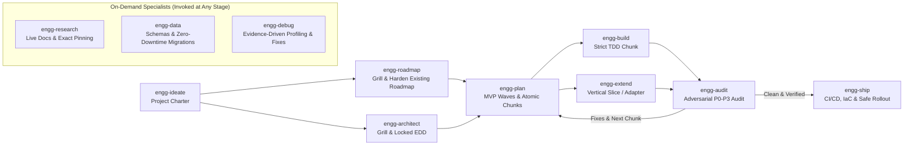

<div align="center">

# Unified Engineering Skills Suite (`engg-skills-suite`)

**One model-agnostic, stack-agnostic suite of 11 Principal-grade Agent Skills covering the entire software engineering lifecycle — from raw idea and roadmap grilling to strict TDD, adversarial auditing, zero-downtime migrations, and production shipping.**

[](https://agentskills.io)
[](#-the-11-skill-catalog)
[](#-supported-engineering-surfaces)
[](LICENSE)

[Why This Suite](#-why-this-suite-exists) • [The 11 Skills](#-the-11-skill-catalog) • [How I Use It](#-how-i-use-it-real-workflows--why) • [Install & Setup](#-installation--idecli-setup) • [Repo Structure](#-repository-structure)

</div>

---

## Why This Suite Exists

AI coding agents are fast—until they drift. Without strict guardrails, different models invent inconsistent architectures, skip edge-case tests, guess outdated package versions, bloat roadmaps, and silently introduce security or concurrency bugs.

This repository packages my personal engineering operating system into **11 portable, open-standard (`SKILL.md`) skills** so **any LLM in any CLI or IDE** enforces the exact same discipline across every repository I touch:

- **Timeless Engineering Design:** Strict **SOLID**, **DRY** (knowledge, not coincidental code), **KISS**, **ATOMIC** (modular composition, atomic state transitions, atomic commits), and **Hexagonal / Ports & Adapters** dependency flow.
- **Five Non-Negotiable Production Invariants:** Explicit Contracts First, Defense-in-Depth Security, Bounded Everything (timeouts, pools, payloads, memory, frame budgets), Observable by Default, and Graceful Lifecycle.
- **Zero Premature Code & Zero Rubber-Stamping:** Architecture and roadmaps get grilled _before_ coding; tests get written _before_ implementation; every diff gets adversarially audited (`P0`–`P3`) _before_ commit.
- **Progressive Disclosure for Speed & Token Efficiency:** Every `SKILL.md` stays lean (under 150 lines, enforced by the validator). Heavy grill banks, 5-category test matrices, domain profiles, and audit checklists live in `references/` and load strictly on demand.
- **100% Vendor-Neutral & Model-Agnostic:** Built strictly on the open `agentskills.io` specification—works identically with Claude Code CLI, Antigravity CLI, Antigravity IDE, Codex, Cursor, GitHub Copilot, OpenCode, or any web LLM.

---

## End-to-End Engineering Loop



---

## The 11-Skill Catalog

| #   | Skill                                                | Stage           | What It Does                                                                                                                                                                      | When I Reach for It                                                                            |
| --- | ---------------------------------------------------- | --------------- | --------------------------------------------------------------------------------------------------------------------------------------------------------------------------------- | ---------------------------------------------------------------------------------------------- |
| 1   | **[`engg-ideate`](skills/engg-ideate/SKILL.md)**       | Ideation        | Pressure-tests raw concepts, compares 2–3 approaches, exposes fatal risks, and locks a V1 **Project Charter** with explicit non-goals.                                            | Starting from a blank page or evaluating whether an idea is worth building.                    |
| 2   | **[`engg-roadmap`](skills/engg-roadmap/SKILL.md)**     | Roadmap         | Reality-checks an existing roadmap against actual code, grills scope with a 50% Timeline Razor, re-sequences risk-first, and routes every milestone to the right execution skill. | Tightening an in-progress product roadmap, cutting bloat, or accelerating a stalled repo.      |
| 3   | **[`engg-architect`](skills/engg-architect/SKILL.md)** | Architecture    | Runs a 3–5 round Staff-level Grill Session with zero hand-waving and locks a decision-complete **Engineering Design Doc (EDD)** + ADRs.                                           | Greenfield systems, golden templates, or major new subsystems before writing code.             |
| 4   | **[`engg-plan`](skills/engg-plan/SKILL.md)**           | Planning        | Breaks any EDD, hardened roadmap milestone, or audit backlog into MVP-first progressive Waves and thin vertical **Atomic Chunks** (1–5 files each).                               | Turning an approved design or next milestone into an executable build queue.                   |
| 5   | **[`engg-build`](skills/engg-build/SKILL.md)**         | Build & TDD     | Implements one chunk at a time via strict **Red → Green → Refactor** with a mandatory **5-category Test Matrix** (Happy, Fuzz, Concurrency, Fault, Security).                     | Building core functionality without letting test-after drift creep in.                         |
| 6   | **[`engg-extend`](skills/engg-extend/SKILL.md)**       | Evolution       | **Mode A:** Adds a vertical feature slice matching repo conventions. **Mode B:** Adds/swaps an adapter behind a port with **shared LSP contract tests**.                          | Growing an existing repo cleanly or swapping DBs, caches, queues, SDKs, or UI/engine backends. |
| 7   | **[`engg-audit`](skills/engg-audit/SKILL.md)**         | Review & Harden | **Mode A:** Mandatory post-chunk/PR audit. **Mode B:** Full existing codebase/subsystem hardening. **Mode C:** Audits & tightens specs/plans written by another LLM.              | Before every commit, when onboarding onto messy code, or validating another model's plan.      |
| 8   | **[`engg-research`](skills/engg-research/SKILL.md)**   | Verification    | Enforces zero-memory-guessing live doc/CVE lookup and strict exact dependency, lockfile, and container digest pinning.                                                            | Picking libraries, upgrading major versions, or checking current API signatures.               |
| 9   | **[`engg-debug`](skills/engg-debug/SKILL.md)**         | Diagnostics     | Scientific debugging & profiling loop (Reproduce → Measure → Hypothesize → Isolate → Root-Cause Fix → Regression Test).                                                           | Hunting races, memory leaks, p99 spikes, Web Vitals jank, mobile ANRs, or game frame drops.    |
| 10  | **[`engg-data`](skills/engg-data/SKILL.md)**           | Persistence     | Schema modeling, index design, `EXPLAIN ANALYZE` verification, throttled backfills, and **zero-downtime expand-and-contract migrations**.                                         | Touching databases, writing migrations, or eliminating slow queries and lock hazards.          |
| 11  | **[`engg-ship`](skills/engg-ship/SKILL.md)**           | Release & Ops   | Hardened CI quality gates, non-root immutable containers, declarative IaC, observability/SLOs, Production Readiness Review, rollbacks, and atomic commits.                        | Setting up CI/CD, containerizing, deploying safely, or writing rollback runbooks.              |

---

## Supported Engineering Surfaces

Domain-specific profiles live inside `references/` so the exact same skills adapt natively across every stack:

| Surface                   | Architectural Focus                                               | Key Budgets & Checks Enforced                                                                               |
| ------------------------- | ----------------------------------------------------------------- | ----------------------------------------------------------------------------------------------------------- |
| **Backend & Distributed** | Hexagonal (`transport -> service -> domain -> ports <- adapters`) | p95/p99 latency, idempotency, tenant isolation (anti-IDOR), SSRF guards, SIGTERM draining                   |
| **Web Client**            | Atomic UI + Feature-Sliced domain separation                      | Core Web Vitals (LCP/INP/CLS), bundle caps, WCAG AA accessibility, `AbortController`, XSS/CSP               |
| **Mobile Client**         | Clean MVVM / MVI + Unidirectional Data Flow (UDF)                 | 16.6ms/8.3ms frames, zero main-thread I/O, offline sync, process-death restore, Keychain/Keystore           |
| **Game Client**           | Fixed-timestep simulation decoupled from rendering; ECS/FSM       | Hard frame-time & zero per-frame GC allocations, object pooling, atomic versioned saves, server authority   |
| **Database & Data**       | Schema-first contracts, OLTP vs. OLAP separation                  | Lock timeouts, `CONCURRENTLY` indexes, keyset pagination, `EXPLAIN (ANALYZE, BUFFERS)`, expand-and-contract |
| **Infra & DevOps**        | Modular declarative IaC, immutable artifacts                      | Least-privilege IAM/OIDC, non-root read-only containers, pinned digests/SHAs, canary & tested rollbacks     |

---

## How I Use It (Real Workflows & Why)

I don't invoke all 11 skills on every task—I compose them into **4 repeatable loops** depending on what I'm doing. (See [`docs/WORKFLOWS.md`](docs/WORKFLOWS.md) for the complete prompt cookbook.)

### 1. Accelerating an In-Progress Project (Roadmap Grill → Ship)

> **Why:** In-progress repos accumulate bloated roadmaps, hidden prerequisites, and fragile untested seams. Grilling the roadmap against the _real codebase_ cuts weeks of wasted effort before writing another line.

1. Keep your roadmap in `docs/ROADMAP.md`.
2. **Grill & harden it:**
   ```text
   /engg-roadmap Audit docs/ROADMAP.md against the current repository state.
   Run your interactive grill rounds to expose reality gaps, cut scope bloat, and re-sequence risk-first, then emit the Tightened Roadmap Delta and Suite Routing Matrix.
   ```
3. **Chunk only the next active milestone:**
   ```text
   /engg-plan Break Milestone 1 from the hardened docs/ROADMAP.md into MVP-first Wave 1 and Wave 2 atomic chunks.
   ```
4. **Ship chunk by chunk:**
   ```text
   /engg-build Execute Chunk 1 using strict TDD (5-category test matrix first), then run /engg-audit (Mode A) before I commit.
   ```

### 2. Building a Greenfield Project from Zero

> **Why:** Prevents architectural debt, premature complexity, and unverified stack choices from getting baked into day-one scaffolding.

`engg-ideate` → `engg-architect` _(+ `engg-research`)_ → `engg-plan` → **[`engg-build` → `engg-audit`]** _(repeat per chunk)_ → `engg-ship`

### 3. Tightening an Existing Codebase or Another LLM's Spec

> **Why:** Refactors without safety-net tests break production, and plans drafted by other models often hide missing trust boundaries, unbounded queries, or stale API versions.

- **Existing repo/module:** `/engg-audit Run Mode B on src/payments/ — give me a 6-pillar scorecard, severity-ranked findings, and a strangler-fig hardening plan.`
- **External spec/plan:** `/engg-audit Run Mode C on docs/proposal.md — flag every missing budget, security gap, stale tech claim, and over-engineered piece with a Tightened Spec Delta.`

### 4. Daily Specialist Loops

- **Adding a feature or swapping a DB/SDK:** `/engg-extend` (Mode A for vertical slices, Mode B for port adapters with shared contract tests) → `/engg-audit`
- **Fixing a nasty bug or slow path:** `/engg-debug` (forces reproduction + profiler evidence before touching code) → regression test → `/engg-audit`
- **Changing a production database schema:** `/engg-data` (expand-and-contract safety checklist + query plan check) → `/engg-audit`
- **Shipping to production:** `/engg-ship` (fast-fail CI gates, hardened container/IaC, Production Readiness Gate, verified rollback)

---

## Installation & IDE/CLI Setup

### Where Each Tool Discovers Skills

| Tool                                    | Project Scope (Git-tracked in your repo)                            | Global Scope (Available in every project) |
| --------------------------------------- | ------------------------------------------------------------------- | ----------------------------------------- |
| **Antigravity IDE**                     | `<repo>/.agents/skills/<skill>/`                                    | `~/.gemini/config/skills/<skill>/`        |
| **Antigravity CLI**                     | `<repo>/.agents/skills/<skill>/`                                    | `~/.gemini/config/skills/<skill>/`        |
| **Claude Code CLI**                     | `<repo>/.claude/skills/<skill>/` _(symlinked to `.agents/skills/`)_ | `~/.claude/skills/<skill>/`               |
| **Codex / Cursor / Copilot / OpenCode** | `<repo>/.agents/skills/<skill>/` _(open standard)_                  | Tool-specific global skills folder        |

> **Single-Source-of-Truth Pattern:** The installer stores one canonical copy (`.agents/skills/` for project scope, or `~/.engg-skills-suite/skills/` for global scope) and symlinks it into tool-specific paths so updating one file updates **every CLI and IDE simultaneously**.

---

### Quick Install (Automated Scripts)

#### macOS / Linux

```bash
git clone https://github.com/devnadeemashraf/engg-skills-suite.git
cd engg-skills-suite
chmod +x install.sh

# Option 1: Install globally across Claude Code CLI + Antigravity CLI + Antigravity IDE
./install.sh --global

# Option 2: Install directly into an active project repo
./install.sh --project /path/to/your-project
```

_Options: `--copy` (copy files instead of symlinking), `--dry-run` (show what would change), `--uninstall` (remove only this suite's skills; anything else in those folders is left alone)._

#### Windows (PowerShell)

```powershell
git clone https://github.com/devnadeemashraf/engg-skills-suite.git
cd engg-skills-suite

# Option 1: Global install
.\install.ps1 -Scope Global

# Option 2: Project-scoped install
.\install.ps1 -Scope Project -ProjectPath "C:\path\to\your-project"
```

_Options: `-Copy`, `-DryRun`, `-Uninstall` (same behaviour as the shell installer). Links are symbolic links when Windows allows them (Developer Mode or admin), otherwise directory junctions, which need no special rights. On Windows, use `install.ps1` rather than `install.sh` under Git Bash: Git Bash's `ln -s` silently makes copies unless native symlinks are enabled._

---

### How to Use in Your Favorite IDE / CLI

- **Claude Code CLI:**
  1. Verify install: type `/` to browse available skills, or ask `"What skills do you have?"`.
  2. Invoke explicitly with slash commands (`/engg-roadmap`, `/engg-build`, `/engg-audit`) or let Claude auto-activate them from natural requests.
- **Antigravity CLI:**
  1. Start a session and run `/skills` to confirm all 11 `engg-*` skills are loaded.
  2. Invoke via `/engg-roadmap`, `/engg-plan`, `/engg-build`, etc., or reference the skill by name.
- **Antigravity IDE:**
  1. Open your workspace (restart the window once after a fresh global install).
  2. Type `/` in the Agent Panel to browse and trigger any `engg-*` skill directly—or ask naturally (e.g., _"Use engg-audit Mode B to harden this service"_).
- **Cursor / Codex CLI / GitHub Copilot / OpenCode:**
  - Run `./install.sh --project /path/to/your-project`—all modern open-spec agents automatically discover `<repo>/.agents/skills/<skill>/SKILL.md`.
- **Any Web LLM (Chat UI without filesystem skill discovery):**
  - Upload or paste the specific `skills/<skill>/SKILL.md` plus its `references/*.md` files into a Project/Gem/Custom GPT instruction set, or attach the relevant skill folder when starting a session.

---

## Repository Structure

```text
engg-skills-suite/
├── .github/workflows/validate.yml   # CI: validator, tests, linters, installers on 3 OSes
├── docs/
│   └── WORKFLOWS.md                 # End-to-end prompt recipes & chaining patterns
├── skills/
│   ├── engg-ideate/                  # Idea framing & Project Charter
│   ├── engg-roadmap/                 # Existing roadmap grilling, reality-check & routing
│   ├── engg-architect/               # Staff-level Grill Session & locked EDD/ADRs
│   ├── engg-plan/                    # MVP-first Waves & Atomic Chunk decomposition
│   ├── engg-build/                   # Strict TDD (5-category Test Matrix) chunk builder
│   ├── engg-extend/                  # Vertical slices & contract-tested swappable adapters
│   ├── engg-audit/                   # Adversarial P0-P3 audit (PR, brownfield repo, external spec)
│   ├── engg-research/                # Zero-memory-guessing live docs & version pinning
│   ├── engg-debug/                   # Evidence-driven debugging & performance profiling
│   ├── engg-data/                    # Schema design, query plans & zero-downtime migrations
│   └── engg-ship/                    # CI/CD, IaC, containers, PRR & safe rollouts
├── install.sh                       # macOS / Linux installer (Global & Project)
├── install.ps1                      # Windows PowerShell installer (Global & Project)
├── tools/validate_suite.py          # Agent Skills spec & suite-rule validator
├── tools/pin_requirements.py        # Regenerates the hash-pinned requirements files
├── tests/                           # Validator tests + installer smoke tests
├── CONTRIBUTING.md                  # Authoring standards for extending the suite
└── LICENSE                          # Apache-2.0
```

---

## Validation & Quality Gates

Before pushing changes, run the validator and tests. The validator checks `agentskills.io` compliance (frontmatter parsed as real YAML, field limits, name matches folder), the line budget, resource files (broken, nested, or never referenced), self-contained skill folders, and vendor neutrality:

```bash
python -m venv .venv && . .venv/bin/activate          # Windows: .venv\Scripts\activate
python -m pip install --require-hashes -r requirements-dev.txt
python tools/validate_suite.py
python -m pytest -q
bash tests/installer_smoke.sh                         # Windows: .\tests\installer_smoke.ps1
```

GitHub Actions runs all of this on every push and pull request, plus shellcheck, actionlint, zizmor, PSScriptAnalyzer, and installer smoke tests on Linux, macOS, and Windows. Every action is pinned to a commit SHA and every Python dependency is hash-pinned. See [`.github/workflows/validate.yml`](.github/workflows/validate.yml).
