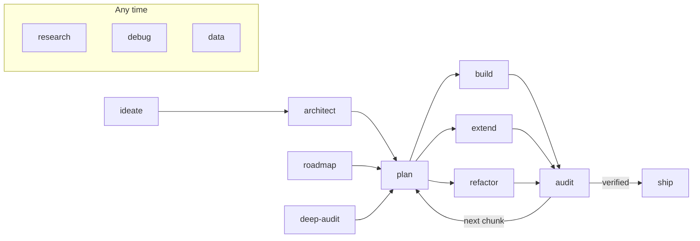

<div align="center">

# engg-skills-suite

**Make your AI coding agent work like a disciplined senior engineering team.**

Thirteen open-standard Agent Skills that teach any coding agent to plan before it codes, test before it builds, respect your architecture, audit whole codebases with real open-source tools, and ship safely, on any stack.

[](https://github.com/devnadeemashraf/engg-skills-suite/actions/workflows/validate.yml)
[](https://agentskills.io/specification)
[](#the-skills)
[](LICENSE)

[What it is](#what-it-is) · [How it works](#how-it-works) · [The skills](#the-skills) · [Day-to-day use](#day-to-day-use) · [Setup](docs/SETUP.md) · [Recipes](docs/WORKFLOWS.md)

</div>

---

## What it is

AI coding agents are fast, but left alone they drift:
- they invent a new architecture each session
- they test only the happy path, guess package versions from memory, and "clean up" code nobody asked them to touch
- they report success without proof

This suite is a set of **skills**: plain Markdown instruction packs that the agent loads when a task needs them. Each skill turns one part of engineering into a procedure the agent follows:
- frame an idea, then design and plan it
- build test-first
- audit, refactor, debug, handle data
- research versions, then release

The skills follow the open [Agent Skills specification](https://agentskills.io/specification), so the same files work in Claude Code, Codex, Cursor, GitHub Copilot and Antigravity. They are stack-agnostic: backend, web, mobile, games, databases and infrastructure all use the same skills, with surface-specific checklists inside.

**You keep the decisions.** The skills ask before they assume: which delivery mode you want, whether your existing architecture is fixed, and whether a tool may be installed. Then they hold the agent to your answers.

## How it works

Five ideas run through every skill. You don't need to memorize them; the skills apply them for you.

### 1. Ask first, then stay in lane: delivery modes

At the start of any effort, the agent asks one question and records the answer in `.engg/delivery.yaml`:

| Mode | You get | Best when |
|---|---|---|
| **`mvp-first`** | The core flow working end-to-end quickly, with everything critical done properly (security, architecture rules, tests, CI). Then small increments: features, improvements, fixes. | The idea is unproven, a demo or deadline is coming, or the scope is still moving |
| **`full-sequence`** | Every planned part built one by one, each finished before the next | The scope is fixed and understood; libraries, platforms, infrastructure |

It also records the **baseline**. If your project already has an architecture and tooling, they are **fixed**: the agent builds within them and writes improvement ideas into a backlog instead of redesigning. Only an explicit "redo it" opens a redesign. Neither mode ever lowers quality; `mvp-first` cuts scope, not standards.

### 2. Architecture as a contract a machine checks

Your agreed architecture lives in `.engg/architecture.yaml`: the layers, which layer may import which, external-package limits, and module isolation. `compile_contract.py` turns it into the native checker for your stack (dependency-cruiser, import-linter or go-arch-lint), so the same rules run in your editor, in pre-commit and in CI. A rule a checker can't express is reported as *not covered*, never silently dropped.

### 3. Tools first, with your consent

Reading thousands of lines and "remembering" them is slow and inaccurate. The skills use free, open-source tools wherever a tool does the job better:
- a code knowledge graph ([graphify](https://github.com/safishamsi/graphify))
- compact web reading ([only-cli](https://github.com/only-cli/oc))
- complexity, duplication and dead-code finders
- secret and vulnerability scanners
- architecture checkers

Nothing is installed without asking. The agent explains what the tool does, why this task needs it, whether any data leaves your machine, and how to remove it. If you decline, it says what accuracy is lost. See the [toolchain registry](shared/references/toolchain.md).

### 4. Rigor that matches the risk

Every change gets a **risk tier**, and the tier decides how much proof it needs:

| Tier | Example | Required proof |
|---|---|---|
| T0 | docs, copy | formatter and linter |
| T1 | internal logic, a UI component | plus unit tests, typecheck, architecture check |
| T2 | public API, persistence, concurrency | plus all five test categories, contract tests, an adversarial review |
| T3 | auth, money, personal data, migrations, infrastructure | plus mutation testing, security scans, a threat note, and your sign-off |

### 5. Evidence, and a ratchet

- **Evidence:** every claim cites a file and line or a tool result, and "verified" means a command ran and passed. Nothing is deleted unless two independent signals agree it's unused.
- **The ratchet:** in existing code, the ratchet (`ratchet.py`) records today's violations as a baseline. CI then fails on any new one, and the baseline can only shrink. Messy code gets cleaner every week and can't quietly slide back.

## The skills

| Stage | Skill | Use it to | You get |
|---|---|---|---|
| **Shape** | [`engg-ideate`](skills/engg-ideate/SKILL.md) | Turn a rough idea into something worth building | A project charter: problem, users, the riskiest assumptions, a sharp V1, numeric success criteria |
| | [`engg-roadmap`](skills/engg-roadmap/SKILL.md) | Pressure-test an existing roadmap against the real code | A hardened roadmap, cut to what matters, risk-first, each milestone routed to a skill |
| | [`engg-architect`](skills/engg-architect/SKILL.md) | Design a system, or write down an existing one | A design doc, decision records, C4 diagrams, and the architecture contract |
| **Plan** | [`engg-plan`](skills/engg-plan/SKILL.md) | Break a design, milestone or audit into work | Small vertical chunks, each with a risk tier, exact gate commands, and a rollback |
| **Build** | [`engg-build`](skills/engg-build/SKILL.md) | Implement a chunk | Tests written first, then clean code, verified by your real commands |
| | [`engg-extend`](skills/engg-extend/SKILL.md) | Add a feature or swap a dependency inside an existing architecture | A new slice or adapter matching your conventions, with shared contract tests |
| | [`engg-refactor`](skills/engg-refactor/SKILL.md) | Clean up without changing behaviour | Behaviour pinned by tests, dead code removed on evidence, the ratchet going down |
| | [`engg-data`](skills/engg-data/SKILL.md) | Change a schema, query or backfill | Zero-downtime migrations, linted SQL, query plans on realistic data |
| **Verify** | [`engg-audit`](skills/engg-audit/SKILL.md) | Review a diff, a pull request or a spec | Severity-ranked findings (P0–P3), with P0/P1 fixed and regression-tested |
| | [`engg-deep-audit`](skills/engg-deep-audit/SKILL.md) | Audit a whole codebase layer by layer | A tool-built map, a unit-by-unit review saved on disk, a scorecard, strip and move lists, fix waves |
| | [`engg-debug`](skills/engg-debug/SKILL.md) | Find the root cause of a bug or slowdown | A reproduction, profiler evidence, the fix, and a regression test |
| | [`engg-research`](skills/engg-research/SKILL.md) | Pick or upgrade a library, check an API | A dated research brief with sources, exact pins, and known vulnerabilities checked |
| **Release** | [`engg-ship`](skills/engg-ship/SKILL.md) | Set up CI/CD, release, roll out | Machine-enforced gates, a pinned supply chain, feature-flagged rollouts with tested rollback |



## Which Skill When

Each request has exactly one skill. When two seem to fit, the right column decides. (`tests/test_triggers.py` keeps this table and the skills' descriptions in step.)

| You want to… | Skill | Not this one, because… |
|---|---|---|
| Turn a vague idea into a charter | `engg-ideate` | `engg-architect` needs a charter first |
| Harden an existing roadmap against the real code | `engg-roadmap` | `engg-plan` chunks one milestone, it doesn't judge the roadmap |
| Design a system and lock its architecture contract | `engg-architect` | `engg-plan` needs a locked design |
| Break a design, milestone or audit report into chunks | `engg-plan` | `engg-build` executes one chunk, it doesn't plan |
| Build new behaviour test-first, or fix a defect test-first | `engg-build` | `engg-refactor` must not change behaviour |
| Add a feature slice or an adapter to an existing architecture | `engg-extend` | `engg-build` is for chunks with no existing slice to follow |
| Review a diff, a pull request, or a spec | `engg-audit` | `engg-deep-audit` is for whole codebases |
| Audit a whole codebase or subsystem against its contract | `engg-deep-audit` | `engg-audit` only sees a diff |
| Clean up or restructure without changing behaviour | `engg-refactor` | `engg-build` adds behaviour |
| Find a bug's or slowdown's root cause | `engg-debug` | `engg-build` assumes the cause is known |
| Design a schema, migration, query, or backfill | `engg-data` | `engg-build` doesn't cover lock safety or backfills |
| Set up CI/CD, release, infrastructure, rollouts | `engg-ship` | `engg-build` stops at a verified chunk |
| Pick or upgrade a library, check versions or APIs | `engg-research` | every other skill delegates version facts here |

---

## Day-to-day use

You can call a skill by name (`/engg-plan …` in tools with slash commands), or just describe the task and let the agent pick the matching skill. Below are the situations you'll meet most, and what happens in each. Copy-paste prompts for all of them are in [docs/WORKFLOWS.md](docs/WORKFLOWS.md).

### Starting something new

1. **`/engg-ideate`** "I want to build ___." The agent asks about the user, the problem and what success looks like. It compares two or three approaches and names the assumptions that would kill the idea. You get a charter with a sharp V1 and explicit non-goals.
2. **Delivery mode.** You're asked `mvp-first` or `full-sequence`. For a new idea, `mvp-first` is usually right, with the core flow written down.
3. **`/engg-architect`**: a few rounds of focused questions, then a design doc, decision records, and `.engg/architecture.yaml`, compiled into a real checker.
4. **`/engg-plan`**: Wave 1 is the walking skeleton. That's the harness, CI and pre-commit, plus the core flow end to end.
5. **`/engg-build` chunk by chunk:** tests first, then code; the gates must pass; then `/engg-audit` on the diff before you commit.

### Your project exists and you're adding the next feature

The architecture and tooling are already set, so the baseline is `existing` and the agent builds within them.
- **A feature that fits an existing pattern:** **`/engg-extend`**. It finds the closest existing slice with the code graph and copies its conventions.
- **New behaviour with no pattern yet:** **`/engg-build`**.
- **Either way:** **`/engg-audit`** on the diff before merging. If the agent notices something worth improving outside the chunk, it goes in the backlog, not into your diff.

### You inherited a messy codebase, or want an honest check-up

1. **`/engg-deep-audit`**. The agent maps the repo with tools first: size, complexity, duplication, dead code, secrets in history, vulnerable dependencies, and architecture violations. Then it reviews one bounded unit at a time, inner layers first, saving progress to disk so a long audit can resume. If there's no architecture contract yet, it drafts one from what exists and asks you to confirm it.
2. **What you get:** a scorecard, severity-ranked findings, a **strip list** (safe to delete, with evidence), a **move list** (code in the wrong place), and fix waves. It also says plainly what it did *not* check.
3. **`/engg-plan`** turns the waves into chunks, and **`/engg-refactor`** works through them. It pins current behaviour with tests first, deletes only on fresh evidence, and the ratchet goes down with every commit.

### Something is broken or slow

**`/engg-debug`**. No guess-patching: it reproduces the problem, measures it, tests its hypotheses (`git bisect run` for regressions), and only then fixes it, with a regression test. Speed claims come with before/after numbers from repeated runs.

### Changing the database

**`/engg-data`**. Migrations are split into backward-compatible steps (expand, backfill, switch, contract) and linted for lock safety. Query plans are checked on realistic data volumes, and backfills can resume after a crash.

### Picking or upgrading a library

**`/engg-research`**. Versions, compatibility ranges and advisories are checked live, never recalled, and you get a dated brief with sources. The same goes for CI actions, which are pinned to exact commit SHAs.

### Releasing

**`/engg-ship`**: required CI checks (including the architecture contract and the ratchet), pinned and linted workflows, an SBOM and signed provenance, a merge queue when it's busy, feature-flagged rollouts, a rollback you've tested, and your DORA delivery metrics.

### What lands in your repository

| Path | What it is | Commit it? |
|---|---|---|
| `.engg/delivery.yaml` | Your delivery mode, baseline and core flow | Yes |
| `.engg/architecture.yaml` | The architecture contract | Yes |
| `.engg/generated/` | Checker configs compiled from the contract | Yes |
| `.engg/baseline/violations.json` | The ratchet baseline | Yes |
| `.engg/toolchain.lock` | The tool versions you approved | Yes |
| `.engg/audit/<run>/` | A deep audit's map, ledger, findings and report | No (local) |

---

## Install

```bash
git clone https://github.com/devnadeemashraf/engg-skills-suite.git
cd engg-skills-suite
./install.sh --global                         # macOS / Linux: every project on this machine
./install.sh --project /path/to/your-repo     # or just one repository
```

```powershell
.\install.ps1 -Scope Global                                   # Windows
.\install.ps1 -Scope Project -ProjectPath "C:\path\to\repo"
```

**[Full setup guide →](docs/SETUP.md)** covers each tool (Claude Code, Codex, Cursor, Copilot, Antigravity, web chats), verifying the install, your first session, the optional open-source tools, updating, uninstalling and troubleshooting.

## Repository layout

```text
skills/           the 13 skills: each a SKILL.md plus references/ and scripts/ it loads on demand
shared/           single source for files several skills use (synced into skills/ by tools/sync_shared.py)
  references/     engineering constitution, delivery modes, architecture contract, toolchain, tool consent
  scripts/        compile_contract.py, ratchet.py, toolcheck.sh / toolcheck.ps1
evals/            fixture repos with known defects, answer keys, a scorer, and recorded runs
docs/             SETUP.md, WORKFLOWS.md, and the v2 design plan
tools/            validator, shared-file sync, requirement pinning, tool-output capture
tests/            tests for every script, the validator, the installers and the trigger table
install.sh/.ps1   installers for macOS, Linux and Windows
```

## Quality

The suite is held to its own standards:
- every skill is validated against the Agent Skills spec
- every script has tests that run the real tools (dependency-cruiser, import-linter) against fixture repos
- CI runs on Linux, macOS and Windows, with actions pinned to commit SHAs, hash-pinned Python dependencies, and a rule that fails the build if any test is skipped

See [CONTRIBUTING.md](CONTRIBUTING.md) to add or change a skill.

## License

[Apache-2.0](LICENSE)
